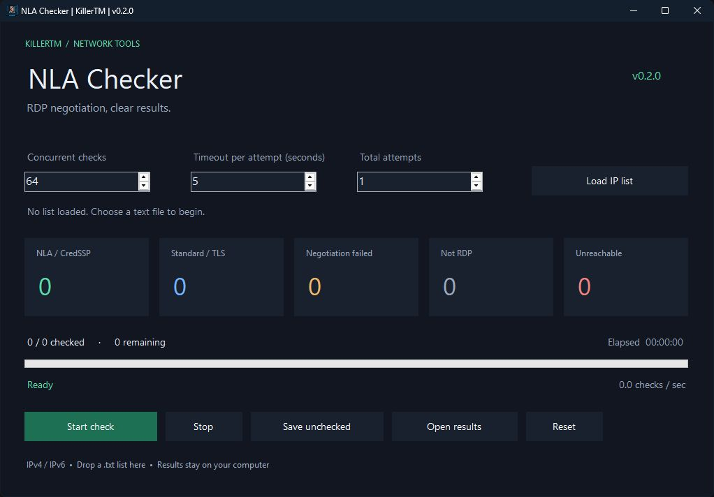

# NLA Checker — راهنمای فارسی

این برنامه برای بررسی مذاکرهٔ اولیهٔ RDP روی فهرست IP است. نتیجه‌ها در پنج دسته نمایش داده می‌شوند: NLA/CredSSP، RDP معمولی یا TLS، خطای مذاکره، پاسخ غیر RDP و اتصال ناموفق.

[دانلود نسخهٔ ۰٫۲٫۰](https://github.com/unknown-killer/NLA-Checker/releases/tag/v0.2.0) · [English](README.md) · [تغییرات نسخه](CHANGELOG.md)



## تغییرات اصلی

در نسخهٔ قبلی، خروجی‌های NLA و بدون NLA جابه‌جا ذخیره می‌شدند. شمارنده‌ها هم در اجرای هم‌زمان ممکن بود دقیق نباشند و بعضی حلقه‌ها بعد از تمام‌شدن فهرست همچنان اجرا می‌شدند. این موارد اصلاح شده‌اند. هستهٔ جدید از عملیات شبکهٔ async استفاده می‌کند و دیگر برای هر کار یک نخ جدا نمی‌سازد.

وابستگی به DLL بیرونی Bunifu و بسته‌های NuGet حذف شده است. برنامه از روی همین مخزن ساخته می‌شود و برای اجرا فقط به دات‌نت فریم‌ورک ۴٫۸ نیاز دارد.

## استفاده

فایل ZIP ریلیز را باز کنید و `UK_NLA_CHECKER.exe` را اجرا کنید.

۱. با **Load IP list** فایل متنی را انتخاب کنید، یا آن را روی پنجره بکشید.
۲. تعداد کارهای هم‌زمان، زمان انتظار و تعداد کل تلاش‌ها را تنظیم کنید. پیش‌فرض‌ها به‌ترتیب ۶۴، پنج ثانیه و یک تلاش هستند.
۳. **Start check** را بزنید. **Stop** اتصال‌های فعال را می‌بندد و آدرس‌های باقی‌مانده را ذخیره می‌کند.
۴. با **Open results** پوشهٔ خروجی را باز کنید. برای ادامهٔ کارِ متوقف‌شده، فایل `Not_Checked.txt` را بارگذاری کنید. زدن دوبارهٔ Start بدون بارگذاری این فایل، کل فهرست اولیه را در یک پوشهٔ جدید بررسی می‌کند.

```text
# هر آدرس در یک خط
192.0.2.10
192.0.2.11:3390
2001:db8::10
[2001:db8::11]:3390
```

پورت پیش‌فرض ۳۳۸۹ است. دامنه، بازهٔ CIDR و شکل کوتاه‌شدهٔ IPv4 پذیرفته نمی‌شود. ورودی‌های تکراری حذف می‌شوند و تعداد خطوط نامعتبر، خالی و توضیحات نمایش داده می‌شود. عدد ۳ در **Total attempts** یعنی یک تلاش اولیه و حداکثر دو تلاش مجدد؛ فقط اتصال ناموفق و timeout تکرار می‌شوند.

## فایل‌های خروجی

برای هر اجرا پوشه‌ای جدا در مسیر زیر ساخته می‌شود:

```text
%LOCALAPPDATA%\KillerTM\NLA Checker\Results
```

| فایل | محتوا |
| --- | --- |
| `NLA.txt` | پاسخ انتخاب CredSSP یا درخواست صریح CredSSP از سمت سرور |
| `No_NLA.txt` | انتخاب RDP معمولی یا TLS، از جمله پاسخ قدیمی RDP |
| `Negotiation_Failed.txt` | پاسخ RDP با خطای مذاکره یا پروتکل انتخاب‌شدهٔ غیرمنتظره |
| `Not_RDP.txt` | پاسخ نامعتبر، ناقص یا غیر RDP |
| `Error.txt` | خطای اتصال یا پایان زمان انتظار، پس از تعداد تلاش تعیین‌شده |
| `Not_Checked.txt` | آدرس‌های در صف و آدرس‌هایی که هنگام توقف هنوز کامل بررسی نشده بودند |
| `Results.csv` | همهٔ نتیجه‌های کامل، تعداد تلاش، زمان بررسی و جزئیات |

انتخاب NLA در این مذاکره، به‌تنهایی ثابت نمی‌کند که سرور برای همهٔ اتصال‌ها NLA را اجباری کرده است. timeout هم به معنی نبودن قطعی RDP نیست. برنامه وارد حساب نمی‌شود و رمز عبور یا سیاست امنیتی سرور را آزمایش نمی‌کند. فقط سیستم‌هایی را بررسی کنید که متعلق به شما هستند یا اجازهٔ بررسی‌شان را دارید.

خروجی‌ها بافر می‌شوند و هنگام نوشتن مداوم تقریباً هر یک ثانیه، و در پایان یا توقف عادی، روی دیسک نوشته می‌شوند. بستن اجباری فرایند یا قطع برق می‌تواند آخرین سطرهای بافرشده را از بین ببرد. خطای دیسک اجرای بررسی را متوقف می‌کند و در رابط نمایش داده می‌شود.

## ساخت از سورس

Visual Studio Build Tools را همراه با ابزارهای ساخت دسکتاپ دات‌نت و targeting pack نسخهٔ ۴٫۸ نصب کنید، سپس اجرا کنید:

```powershell
./scripts/build.ps1
```

این دستور نسخهٔ Release را می‌سازد و تست‌ها را اجرا می‌کند. تست‌های شبکه فقط روی loopback محلی اجرا می‌شوند. فایل اجرایی در `NLA_CHECKER/bin/Release` قرار می‌گیرد. برای ساخت ZIP قابل انتشار، پس از بیلد موفق `./scripts/package.ps1` را اجرا کنید.

[گزارش آزمون‌ها و اندازه‌گیری کارایی](docs/VALIDATION.md)
