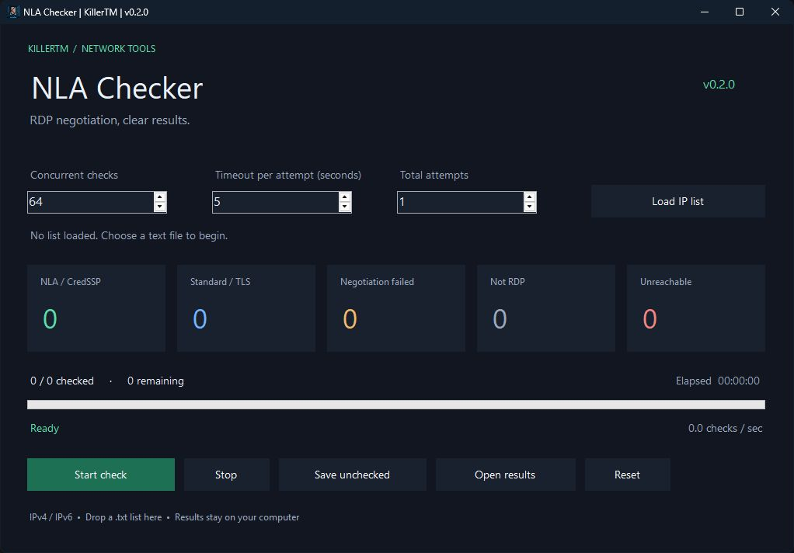

# NLA Checker

A small Windows utility for checking RDP negotiation on a list of IP addresses. It separates CredSSP/NLA, standard RDP or TLS, negotiation failures, non-RDP replies and unreachable endpoints.

[Download v0.2.0](https://github.com/unknown-killer/NLA-Checker/releases/tag/v0.2.0) · [راهنمای فارسی](README.fa.md) · [Changes](CHANGELOG.md)



## What changed in 0.2.0

The old version could put NLA results in the wrong file, lose counter increments and keep worker loops running after the list ended. This release fixes those paths and replaces dedicated threads with bounded asynchronous workers. The app now builds without the external Bunifu DLL or NuGet packages.

- IPv4, IPv4:port, IPv6 and [IPv6]:port input; default port 3389.
- Duplicate removal and counts for invalid, blank and comment lines.
- 1–512 concurrent checks, a timeout for each complete attempt, and 1–10 total attempts.
- Stop closes active connections and saves queued **and** interrupted addresses.
- Separate text files plus a CSV with status, attempt count, elapsed time and diagnostic detail.
- A dark interface with readable buttons, live counts and average checks per second.

## Run

Extract the release ZIP and open `UK_NLA_CHECKER.exe`. Windows with .NET Framework 4.8 is required; no installer or extra DLL download is needed.

1. Choose **Load IP list**, or drop a text file on the window.
2. Set concurrency, timeout and total attempts. The defaults are 64, 5 seconds and 1 attempt.
3. Click **Start check**. **Stop** cancels active work; **Open results** opens the session folder.
4. To continue a stopped run, load its `Not_Checked.txt`. Starting again without loading that file rechecks the original list in a new session.

```text
# One address per line
192.0.2.10
192.0.2.11:3390
2001:db8::10
[2001:db8::11]:3390
```

Hostnames, CIDR ranges and abbreviated IPv4 forms are not accepted. `Total attempts = 3` means one initial attempt and at most two retries. Only unreachable connections and timeouts are retried.

## Results

Each session uses a new folder under `%LOCALAPPDATA%\KillerTM\NLA Checker\Results`.

| File | Meaning |
| --- | --- |
| `NLA.txt` | CredSSP was selected, or the server explicitly required CredSSP. |
| `No_NLA.txt` | Standard RDP or TLS was selected, including a legacy connection confirm. |
| `Negotiation_Failed.txt` | RDP replied, but negotiation failed or selected an unexpected protocol. |
| `Not_RDP.txt` | The reply was malformed, incomplete or not a recognized RDP connection confirm. |
| `Error.txt` | Connection error or timeout after the configured attempts. |
| `Not_Checked.txt` | Queued and interrupted addresses when the run ended. |
| `Results.csv` | All completed results with attempt count, total probe time in milliseconds and detail. |

NLA selection confirms support for this negotiation; it does **not** prove that NLA is enforced for every connection. Likewise, a timeout does not prove that RDP is absent. This tool does not authenticate, test passwords or inspect the server's policy. Check only systems you own or have permission to assess.

Output is buffered and flushed during ongoing writes at roughly one-second intervals, then closed on normal completion or stop. Force-killing the process or losing power can lose buffered rows; this is not a crash-recovery checkpoint system. Disk errors stop the run and are shown in the interface.

## Build and test

Install Visual Studio Build Tools with **.NET desktop build tools** and the **.NET Framework 4.8 targeting pack**, then run:

```powershell
./scripts/build.ps1
```

The build produces `NLA_CHECKER/bin/Release/UK_NLA_CHECKER.exe` and runs the dependency-free test executable. Tests use local loopback servers and injected probes; no public hosts are scanned. See [validation notes](docs/VALIDATION.md) for coverage and the dispatch benchmark.

To package the portable release after a successful build:

```powershell
./scripts/package.ps1
```

Protocol interpretation follows Microsoft's [negotiation response](https://learn.microsoft.com/en-us/openspecs/windows_protocols/ms-rdpbcgr/b2975bdc-6d56-49ee-9c57-f2ff3a0b6817) and [negotiation failure](https://learn.microsoft.com/en-us/openspecs/windows_protocols/ms-rdpbcgr/1b3920e7-0116-4345-bc45-f2c4ad012761) specifications.
